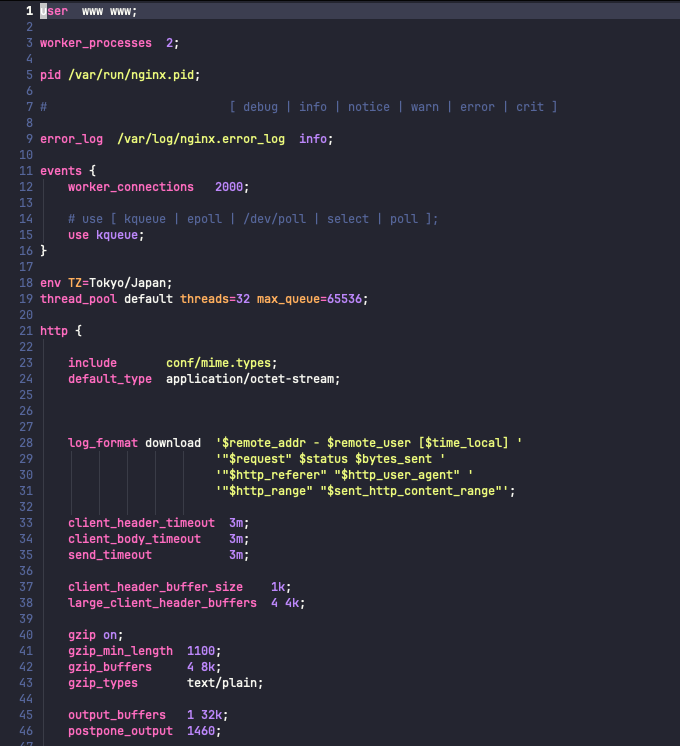

# tree-sitter-nginx

## main impetus

to get more sensible nvim treesitter highlights that just didn't keel over when
encountering `_by_lua_block` directives from nginx lua module

perhaps eventually, to get a good enough tree-sitter based syntax highlight of
similar quality to what [chr4/nginx.vim](https://github.com/chr4/nginx.vim) provided

## prior arts

- <https://github.com/opa-oz/tree-sitter-nginx> what this repo forked from
- <https://gitlab.com/joncoole/tree-sitter-nginx>
- <https://github.com/dlvandenberg/nvim-treesitter-nginx> nvim related in specific
- <https://github.com/nginxinc/crossplane> probably could be used as base for parser,
  smart enough to recognize lua block directives

---

original README:

## Features
- [x] Comments
- [x] Directives
- [x] Location
    - [ ] Regex injection
- [x] If
- [x] Map
- [x] Types
    - [x] `boolean`
    - [x] `number`
    - [x] `string`
    - [x] `auto`
    - [x] `size` (`100k`)
    - [x] `time` (`500ms`)
    - [x] `cpumask`
    - [x] `mask`
    - [x] `file`
    - [x] `log_level`
    - [x] `connection_method`
